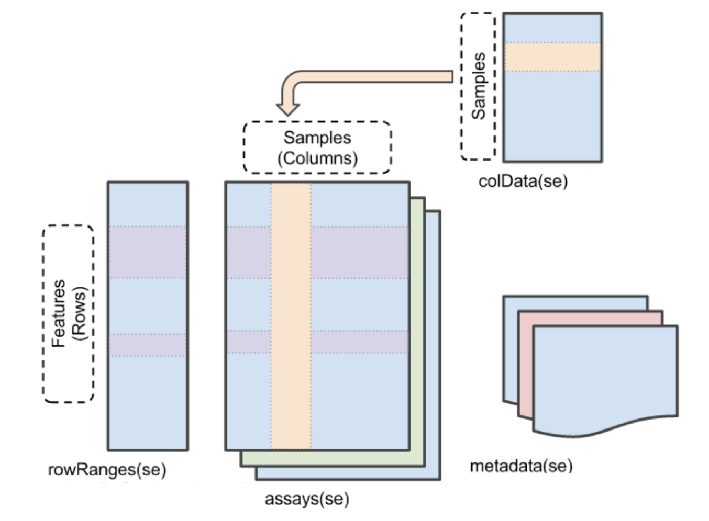

## The Outline for lab practical 2

In this practical, we will conduct a classical functional genomic analysis on a gene expression dataset. Our analysis will involve hierarchical clustering of samples to identify potential patterns, and we'll use feature selection methods to improve tissue labeling prediction. Additionally, we'll cluster genes to determine the number of gene modules, using silhouette analysis to guide our selection. Finally, we'll explore the gene clusters using gene set enrichment analysis in DAVID, providing interpretable insights into the underlying biological processes.

## 1. Construct SummarizedExperiment Object using Expression Matrix and Experimental Design

The data set is stored in a matrix containing the expression levels obtained from a set of microarray experiments, while <mark>the rows of the matrix are genes/probes, and the columns of the matrix are samples</mark>. The expression matrix is stored in a tabular file named `expression.csv` under the directory of lab practical 2. Please load the CSV file into R with the function `read.csv()`. Remember to set the argument `row.names = "probeID"` to render the first column being the row names of the imported data.frame.

Then, we need to read in another important file called `tissue.csv`. This file is a table with rows corresponding to the tissue information of <mark>each sample</mark>. Please read in this file into R with `read.csv()`.

Next, store the expression matrix and the tissue information into a single `summarizedExperiment` object named by `SE`. The expression matrix should input at the `assays=` argument, and the tissue information should input at the `colData=` argument.

Also, we should notice that the `colData` slot in the summarizedExperiment object must be a `DataFrame` object (not `data.frame`), so make sure to convert the tissue into DataFrame with the function `DataFrame()`.

<mark>The reason to construct a `summarizedExperiment` object is to tidy things up. Compared to simultaneously managing multiple variables (expression assays, column designs, row's metadata, and row's GRanges), it is much easier to code with only one variable that includes all of the data.</mark>

<center>

{width="50%"}

</center>

<mark>To access and assign different parts of a `SummarizedExperiment` object, one should use the 4 functions, `assays()`, `colData()`, `rowRanges()`, and `metadata()`, as illustrated on the diagram above.</mark>

<mark>It is hard to find the exact genomic regions for the rows of the microarray data set, so that we will skip the specifying `rowRanges` in the current case. However, a typical NGS assay should be coupled with a set of genome intervals by which the quantification is based on.</mark>

**Task 1.1, Mark: 5%**

```{r, message=FALSE}
## === Hint code, fill the "___"  ============= ##
#tissue <- read.csv(___)
#e <- read.csv(___, row.names = "probeID")
#library(SummarizedExperiment)
#SE <- SummarizedExperiment(assays = ___, colData = DataFrame(___)) # Represent the data into a summarizedExperiment
## ===== Enter your code below  =============== ##
tissue <- read.csv("tissue.csv")
e <- read.csv("expression.csv", row.names = "probeID")
library(SummarizedExperiment)
SE <- SummarizedExperiment(assays = e, colData = DataFrame(tissue)) # Represent the data into a summarizedExperiment
```

Examine the summarizedExperiment object as the following:

```{r}
SE
table(SE$Tissue)

# Metrics to Question 1.2
nrow(SE)
ncol(SE)
length(unique(SE$Tissue))
head(rownames(SE))
head(colnames(SE))
```

**Question 1.2, Mark: 7%**

-   Question 1.2: How many genes or probes are included in this set of the experiment? How many samples are there in total? How many unique tissues are there in total? What are the contents of the `rownames` and `colnames` of the SummarizedExperiment object?

> -   Answer:
> -   The dataset contains **22215 genes/probes** and **189 samples** within **7 unique tissue types**.
> -   The rownames of the SummarizedExperiment object represent **probe or gene identifiers**, while colnames represent **sample identifiers**.

## 2. Hierarchical Clustering by Samples

Next, we will perform hierarchical clustering by the columns of the expression array. <mark>To perform hierarchical clustering, we have to compute distance metrics between the objects in advance</mark>.

The distance metric can be calculated in R using the function `dist()`. Be aware that, <mark>by default, `dist()` is computing distances between rows of the matrix input</mark>. So, if we want to cluster by columns, we need to transform the matrix with the function `t()` to flip the row and columns.

Then, you could use the `hclust()` function to build a hierarchical clustering dendrogram with on the distance metric. In this question, please run hierarchical clustering on <mark>Euclidean distance</mark> between columns of the expression assay, and store the resulting `hclust` object in the variable `hc`.

**Task 2.1, Mark: 8%**

```{r, fig.align='center', fig.width=10}
## === Hint code, fill the "___"  ============= ##
#d <- dist( t(___) ) # Use assay() to extract the expression matrix in SE
#hc <- hclust(___)
## ===== Enter your code below  =============== ##
d <- dist(t(assay(SE)), method = "euclidean") # Use assay() to extract the expression matrix in SE
# length(d) = n * (n - 1) / 2, n is number of samples
hc <- hclust(d)
## ===== Your code is finished  =============== ##
# draw the dendrogram
library(rafalib)
myplclust(hc, labels=SE$Tissue, lab.col=as.fumeric(as.character(SE$Tissue)),cex=0.5)
```

After drawing the dendrogram, you should able to see a tree structure representing the arrangement of clusters of samples. We could observe that <mark>the splitting of the tree branches has a good correlation with the tissue labels</mark>.

Next, we will <mark>retrieve a "partition"</mark> based on the hierachical clustering dendrogram. To achieve this, we need to apply the function `cutree()`. <mark>Set the number of clusters (also called cardinality or K) being the number of tissues</mark>.

Then, tabularize the 2 factors for cluster partition and the true tissue labeling. Display the contingency table. Evaluate the contingency table with `chisq.test()`.

Then, calculate the empirical mutual information between the 2 factors with `DescTools::MutInf()`.

<mark>[Mutual information](https://en.wikipedia.org/wiki/Mutual_information) is a measure of the mutual dependence between two random variables. If the 2 variables are independent, their mutual information will be 0. MI raises if more information gain can be obtained when modeling the dependency between the 2 random variables (compared with the independence modeling).</mark>

**Task 2.2, Mark: 8%**

```{r}
## === Hint code, fill the `___`  ============= ##
#hclusters <- cutree(___, k=__)
#tb <- table(true = ___, cluster = ___)
#tb
#chisq.test(tb)
#DescTools::MutInf(___, ___)
## ===== Enter your code below  =============== ##
hclusters <- cutree(hc, k = length(unique(SE$Tissue)))
tb <- table(true = SE$Tissue, cluster = hclusters)
tb
chisq.test(tb)
DescTools::MutInf(SE$Tissue, hclusters)
```

**Question 2.3, Mark: 7%**

-   Question 2.3: What are the calculated Chi-squared statistics and mutual information? Is the cluster partition significantly associate with the tissue labeling? Is the prediction on tissues perfect or not? Please explain your rationales.

> -   Answer:
> -   Chi-squared is **787.33** (df = 36, p-value \< 2.2e-16), mutual information is **2.090514**.
> -   The extremely small p-value and obviously positive MI value indicate that the cluster partition is significantly associated with the groud truth tissue labels.
> -   However, the clustering is not perfect, because the contingency table is not fully diagonal, and some tissues (e.g., hippocampus) are split across multiple clusters, indicating misclassification. In addition, the Chi-squared test gives a warning that `Chi-squared approximation may be incorrect` due to many low expected counts (0) in some cells of the table, demonstrating uncertainty of interpretation using Chi-square test and clustering prediction.

Change the clustering method into "ward.D2" by setting the `method` argument of the `hclust()` function. Repeat the above analysis, see if the mutual information is improved or not.

**Task 2.4, Mark: 5%**

```{r}
## === Hint code, fill the `___`  ============= ##
#hc <- hclust(___, method = ___)
#hclusters <- cutree(___, k=__)
#tb <- table(true = ___, cluster = ___)
#tb
#DescTools::MutInf(___, ___)
## ===== Enter your code below  =============== ##
hc <- hclust(d, method = "ward.D2")
hclusters <- cutree(hc, k= length(unique(SE$Tissue)))
tb <- table(true = SE$Tissue, cluster = hclusters)
tb
DescTools::MutInf(SE$Tissue, hclusters)
print("The mutual information increased from 2.090514 to 2.250404 after using the ward.D2 method, indicating improved dependency between ground truth label and clustering result. The improved clustering performance suggests advantages of ward.D2 method in our scenario.")
```

## 3. Feature Selection and Heatmap

Then, we will use a simple but most popular <mark>feature extraction technique: keeping only a small number of genes that have the highest variance (expression level differs among different samples)</mark>. This time, we will keep the 85 rows with the highest row variances.

You could use the function `rowVar()` defined in the package `geneFilter` to calculate the variances for genes. Save the index of the selected rows into a variable called `idx`. Using the method ward.D2, conduct hierarchical clustering on columns with the rows subset by `idx`. Please draw the dendrogram and evaluate the mutual information again.

Subsequently, run the prepared code below to plot a heatmap.

**Task 3.1, Mark: 8%**

```{r, message=FALSE, fig.align='center', fig.width=8}
## === Hint code, fill the `___`  ============= ##
#library(genefilter)
#rv <- rowVars(___)
#idx <- order(-___)[___]
#d <- dist(___)
#hc <- hclust(___, method = ___)
#hclusters <- cutree(___, k=__)
#tb <- table(true = ___, cluster = ___)
#tb
#DescTools::MutInf(___, ___)
## ===== Enter your code below  =============== ##
library(genefilter)
rv <- rowVars(assay(SE))
idx <- order(-rv)[1:85]
d <- dist(t(assay(SE)[idx, ]))
hc <- hclust(d, method = "ward.D2")
hclusters <- cutree(hc, k = length(unique(SE$Tissue)))
tb <- table(true = SE$Tissue, cluster = hclusters)
tb
DescTools::MutInf(SE$Tissue, hclusters)
## ===== Your code is finished  =============== ##
library(pheatmap)
library(RColorBrewer)

annotation_col = data.frame(
  Tissue = SE$Tissue
  )
rownames(annotation_col) = colnames(SE)

hmcol <- colorRampPalette(rev(brewer.pal(n = 9, name = "GnBu")))(100)
cols <- palette(brewer.pal(8, "Dark2"))[as.fumeric(as.character(unique(SE$Tissue)))]
names(cols) <- unique(SE$Tissue)

pheatmap(assay(SE)[idx,],
         color = hmcol,
         show_rownames=FALSE,
         show_colnames=FALSE,
         annotation_col=annotation_col,
         annotation_colors = list(Tissue = cols),
         scale = "none",
         clustering_method="ward.D2",
         clustering_distance_cols="euclidean")
```

**Question 3.2, Mark: 7%**

-   Question 3.2: Based on the mutual information and the heatmap, for this time, could we better classify the tissues with only 85 genes? Try to explain why we can obtain the observed performance using less than 0.5% of the total genes?

> -   Answer:
> -   Yes, the mutual information increased, and the heatmap showed clear block structures. These help us classify tissues more accurately.
> -   This may be because only a small subset of genes carries most of the discriminative signal between tissues, while the majority of genes are either non-informative or dominated by noise. By selecting high-variance genes, we effectively enrich for genes that differ across tissues and remove redundant or uninformative features to obtaining clearer classifications.

**Question 3.3, Mark: 7%**

-   Question 3.3: Will we overestimate the performance if we exhaustively search all possible subsets of genes? Please provide your reasons. If the answer is yes, what strategy could be used to deal with this issue?

> -   Answer:
> -   Yes, because such a procedure introduces selection bias, where some subsets may perform well purely by chance due to random variation, leading to over optimistic results.
> -   To address this issue, we should avoid exhaustive search and instead use predefined feature selection criteria (e.g., variance filtering). Another strategy may be use separated subset of data (samples) in feature selection and evaluation. For example, one can use a subset of the samples to select genes and a distinct subset to evaluate clustering performance.

## 4. Determine the Number of Gene Clusters

The quality of the clustering partition can be determined by the average [Silhouette values](https://en.wikipedia.org/wiki/Silhouette_(clustering)) for each cluster.

<mark>The silhouette values quantify how similar an object is to its own cluster (cohesion) compared to other clusters (separation). The silhouette ranges from -1 to +1 (+1 for close to cluster, 0 for uncertainty, -1 for clise to other cluster), where a high value indicates that the object is well matched to its own cluster and poorly matched to neighboring clusters.</mark>

In the following steps, we need to calculate the Silhouette values of <mark>gene clustering</mark>. We will use the `pam()` function defined in `cluster` package to perform this analysis. <mark>The function will run K-medoids clustering on rows of the input matrix</mark>. Set k = 2 so that we will have 2 gene clusters at first. Please use the same 85 rows that have been selected in the last question. Save the output of `pam()` into a variable named by `pamclu`.

**Task 4.1, Mark: 8%**

```{r, fig.align='center', fig.width=6}
set.seed(101)
## === Hint code, fill the `___`  ============= ##
#library(cluster)
#pamclu = pam(___, ___) # Set k = 2, make sure to subset with idx first!
## ===== Enter your code below  =============== ##
library(cluster)
pamclu = pam(assay(SE)[idx, ], k = 2) # Set k = 2, make sure to subset with idx first!
## ===== Your code is finished  =============== ##
plot(silhouette(pamclu), main=NULL)
```

Then, we will try to compute the average silhouette values using different ks. Fill in the middle of the code chunk below to calculate the summarized silhouette statistics for each k. Remember that we need a FOR loop to do this kind of procedure.

```{r, fig.align='center', fig.width=5}
## === Hint code, fill the `___`  ============= ##
#Ks = sapply(2:7, function(i) summary(silhouette(pam(___, ___)))$avg.width)
## ===== Enter your code below  =============== ##
Ks <- sapply(2:7, function(i) summary(silhouette(pam(assay(SE)[idx, ], k = i)))$avg.width)
## ===== Your code is finished  =============== ##
plot(2:7, Ks, xlab="k", ylab="av.silhouette", type="b", pch=19)
```

**Question 4.2, Mark: 7%**

-   Question 4.2: When k = 2, is every single gene well justified in their own clusters? Within our tested ks, what is the optimal number of gene modules? What is the least likely number? Please explain the reason.

> -   Answer:
> -   No, not every gene is well justified when k = 2. Some genes have low or near-zero silhouette values, 2 genes even show negative silhouette values, indicating improper clustering.
> -   Among the tested values (2-7), k = 3 is the optimal number of gene modules, as it achieves the highest average silhouette width around 0.5, indicating the best balance between cohesion and separation.
> -   The least suitable number of clusters is k = 5, which yields the lowest average silhouette value near 0.3, suggesting poor clustering structure and weak separation between clusters.

## 5. Functional Characterization of the Gene Modules

Run hierachical clustering on the 85 genes using method ward.D2, cut the tree using the optimized k derived from the previous step. Store the output of `cutree()` in a variable named by `genecluster`.

**Task 5.1, Mark: 8%**

```{r}
## === Hint code, fill the `___`  ============= ##
#d <- dist(___) # make sure to subset with idx first!
#hc <- hclust(___)
#genecluster <- cutree(___)
## ===== Enter your code below  =============== ##
d <- dist(assay(SE)[idx, ]) # make sure to subset with idx first!
hc <- hclust(d, method = "ward.D2")
genecluster <- cutree(hc, k = 3)
## ===== Your code is finished  =============== ##
sapply(unique(genecluster), function(i) writeLines(names(genecluster)[genecluster == i], paste0("List_",i,".txt"))) # write genes into a txt of each cluster
writeLines(names(genecluster), "Background.txt") # a txt contain all genes
```

After running the last 3 lines of code, you will obtain 3 sets of probe ids saved under the practical directory. Next, go to the website of [DAVID](https://davidbioinformatics.nih.gov/workspace.html?tool=summary_ws).

Do the following steps:

1.  `Start Analysis`

2.  `List` \>\> `Upload User List` \>\> Copy & Paste genes in List_i.txt \>\> provide a list name & taxonomy \>\> `Upload List`

3.  `BG` \>\> `Upload Background` \>\> Copy & Paste genes in Background.txt \>\> provide a list name & taxonomy \>\> `Upload List`

4.  `List` \>\> Select List_i \>\> `Use`

5.  `BG` \>\> Select Background_1 \>\> `Use`

6.  `Clear All` (or `Functional Annotation Tool` for the first analysis) \>\> `Pathways` \>\> `KEGG_PATHWAY` \>\> `Functional Annotation Chart`

7.  Repeat for all the List_is

You can find the explanation for the functional enrichment results at [here](https://davidbioinformatics.nih.gov/documentation/#summary)

**Question 5.2, Mark: 15%**

-   Question 5.2: Report the top five KEGG terms enriched (if existed) for each cluster. Then, explain what are the columns of the `P-value` and `Benjamini` means, and how could we judge each term are statistically significant or not. In combination with the heatmap and the tissue information, please try to present some biological explanations for the enriched terms.

> -   Answer:
> -   Under default thresholds (EASE = 0.1, Count = 2), genes in List_1 clustered in two KEGG pathways (`Complement and coagulation cascades` & `Metabolic pathways`; no KEGG pathway was enriched for List_2; and for List_3, four KEGG pathways were returned: `Protein digestion and absorption`, `AGE-RAGE signaling pathway in diabetic complications`, `Relaxin signaling pathway`, and `Amoebiasis`.
> -   According to [documentations](https://davidbioinformatics.nih.gov/documentation/#summary) in DAVID, the **P-value** is the EASE score, a conservative variant of the Fisher p-value, which estimates how likely the observed overlap between the input gene list and a pathway occurs by chance. The **Benjamini** column provides adjusted p-values by using the linear step-up method of Benjamini and Hochberg, used to control the false discovery rate under multiple testing.
> -   Since many pathways are tested at the same time in DAVID, relying only on the raw p-value would increase the chance of false positives, a pathway is usually judged statistically significant when **Benjamini \< 0.05**.
> -   In this analysis, although some raw P-values were below 0.05, **none of the KEGG terms remained statistically significant after Benjamini correction**, as all adjusted values exceeded 0.05. Nevertheless, **biologically meaningful patterns can still be observed and suggested**. When the genes in the heatmap are grouped into three clusters, they may be plausibly aligned with the three DAVID lists. List_1 most likely corresponds to the cluster showing high expression in the liver, as it exhibits a metabolic and secretory profile consistent with hepatic functions, this was mentioned by [Lao *et al.* (2022)](https://doi.org/10.1021/acs.jproteome.2c00190). List_3 reflects a tissue-signaling profile typical of epithelial and reproductive tissues, it is likely to be associated with the cluster enriched in kidney, colon, endometrium, and placenta ([Bhattacharya *et al*., 2023](https://doi.org/10.3389/fnmol.2023.1155175)). Finally, the cluster in heatmap with elevated expression in hippocampus and cerebellum may be consistent with broader brain-related transcriptional programs, and may correspond to List_2. However, this assignment remains tentative and would require further validation through additional analyses or experiments.

## Session Info

```{r}
sessionInfo()
```
