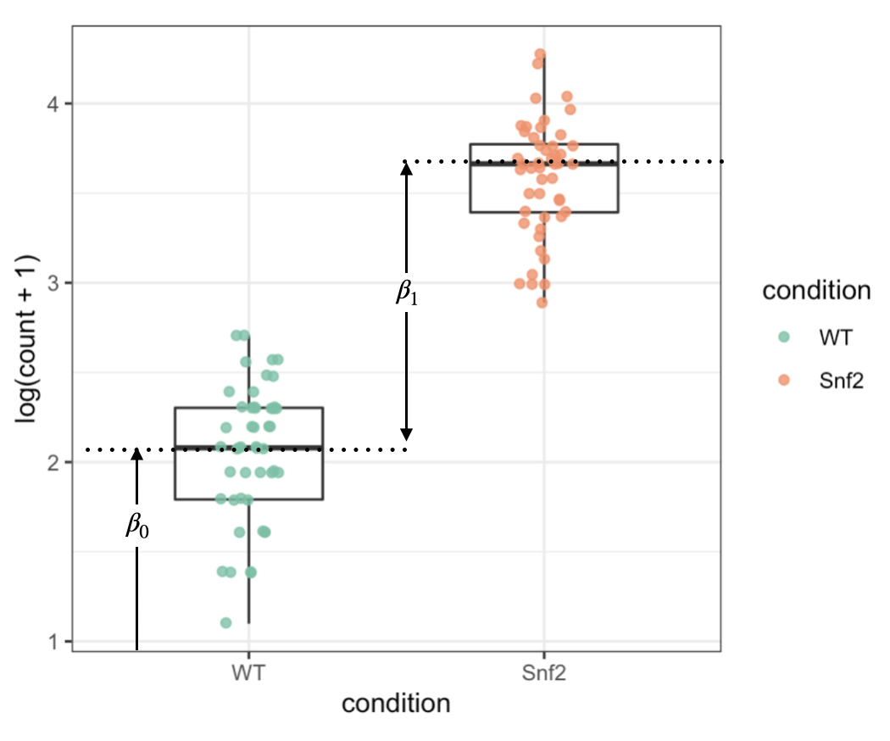

```{r setup, include=FALSE, message=FALSE}
knitr::opts_chunk$set(echo = TRUE,fig.align="center",fig.width = 7, fig.height = 5)
library(ggplot2)
```

# Introduction to section 1

In the first section of this practical, we will implement various <mark>dimensional reduction methods</mark> on <mark>a scRNA-Seq data set</mark>. The sequencing data comes from <mark>cells of mouse neocortex</mark>, which is a brain region governing higher-level cognitive and perceptual functions. The data set is originally produced by the Allen Institute.

The gene expression assay is saved in the RDS file of `scRNA_se.rds` under the current directory.

The code chunk below read the RDS into R and examine its contents. We could see that the data is a `SummarizedExperiment` object having 45768 genes and 511 samples (cells). The expression array can be accessed by `assays(scRNA_se)[["RPKM"]]`, and the ground truth label of the cell types can be retrieved by `scRNA_se$cell_type`.

```{r,message=FALSE}
library(SummarizedExperiment)
scRNA_se <- readRDS("scRNA_se.rds")
scRNA_se 
table(scRNA_se$cell_type) # Biological conditions (experimental design)
str(rowData(scRNA_se)$gene_id) # Gene ids
str(assays(scRNA_se)[["RPKM"]]) # Expression array (in RPKM)
table(colMeans(assays(scRNA_se)[["RPKM"]])) # Check the column averages 
```

## 1-1. Visualizing columns with principal component analysis

We will first visualize the cellular gene expression profiles by plotting the 1st and 2nd PCs of the data.

**Task 1.1.1, Mark: 10%**: Transform the expression values by **log(RPKM+1)** and calculate the PCs using R functions `cov()` and `eigen()`. Save the results of `eigen()` into an object named by `decomp`.

Hint: `cov()` can calculate the empirical covariance matrix between <mark>columns</mark> of a matrix input. `eigen()` can compute the eigenvectors & eigenvalues of a matrix. The output of `eigen()` contains 2 parts: the eigen vector matrix (columns are PCs/factors/loadings/weight combinations) and the eigen values (variance explained along the PCs). The eigen vector matrix can be accessed by `$vectors`, and the eigen values can be accessed by `$values`.

<mark>after `eigen()`: `$values` contains how much variance can be explained by each PC; `$vectors`: contains a matrix, each row is a sample, each column is a PC, extracting certain column gets a set of eigen-genes/single-axis-coordinates under a PC</mark>

```{r}
decomp <- eigen(cov(log(assays(scRNA_se)[["RPKM"]] + 1))) # Implement eigen-decomposition on covariance matrix of log(RPKM+1)
dim(decomp$vectors) # Check dimensionalities of W
# each point is a cell: n_cell*n_cell - 511*511

PC12_df <- data.frame(PC1=decomp$vectors[,1],
                      PC2=decomp$vectors[,2]) # Make a data.frame of PC1 and PC2

ggplot(cbind(PC12_df,label=scRNA_se$cell_type),
         aes(x=PC1,y=PC2,colour=label))+
         geom_point()+
         theme_classic()+
         scale_color_brewer(palette = "Spectral")+
         labs(title = "PCA of log(RPKM+1)")
```

Note that <mark>the empirical covariance matrix along is sufficient to calculate all the principal components</mark>. Hence, <mark>PCA can be understood as an algorithm to summarize the covariance structure between data dimensions using a linear model.</mark>

<mark>Through covariance among all samples (colors represent covariance), we can recognize principle components/co-changing-directions, this has already achieved dimension reduction (gene\*sample -\> sample\*sample).</mark>

<mark>PCA is a lower dimension denotation/summary using a linear model (use matrix mutiplication - linear combiniation).</mark>

```{r, fig.width=5, fig.height=5}
cov_matrix <- cov(log(assays(scRNA_se)[["RPKM"]]+1))
sample_ids <- seq_len(ncol(scRNA_se))
image(cov_matrix, x = sample_ids, y = sample_ids) #The covariance structure between columns (samples)
```

Next, we will try to define <mark>performance measures for the dimensional reduction outcome (conduct clustering using only 2 PCs, test whether biological features are still reserved)</mark>.

**Task 1.1.2, Mark: 5%** First, run K means clustering (K=5) on the matrix of the top 2 PCs (already stored in the variable `PC12_df`) with function `kmeans()`. Subsequently, as we have done in the lab practical 2, compare the clustering result with the ground truth label in `scRNA_se$cell_type` using metrics of mutual information and chi-squared test statistics.

```{r}
set.seed(123)
partition <- kmeans(PC12_df, centers = 5)$cluster # Save the clustering results
(tb <- table(partition, scRNA_se$cell_type)) # Contingency table
DescTools::MutInf(scRNA_se$cell_type, partition) # Mutual information
chisq.test(tb) # Chi-squared statistics
```

The obtained clustering partitions are highly correlated with the true cell categories. However, the cell type 3 & 4 are still not successfully identified from the PCs using K-means.

## 1-2. The effects of normalization and transformation on PCA results

In this section, we will <mark>examine the effect of scaling on PCA</mark>.

The log transformation was previously applied, as it is a natural transformation for count data.

**Task 1.2.1, Mark: 5%** Run PCA without log transformation and compute the mutual information on the K-means clustering result as we have done in Task 1.3.

```{r}
decomp2 <- eigen(cov(assays(scRNA_se)[["RPKM"]])) # Run PCA directly on RPKM
PC12_df <- data.frame(PC1=decomp2$vectors[,1],
                      PC2=decomp2$vectors[,2]) 
ggplot(cbind(PC12_df,label=scRNA_se$cell_type),
         aes(x=PC1,y=PC2,colour=label))+
         geom_point()+
         theme_classic()+
         scale_color_brewer(palette = "Spectral")+
         labs(title = "PCA of RPKM")

set.seed(123)
partition <- kmeans(PC12_df, centers = 5)$cluster
DescTools::MutInf(scRNA_se$cell_type, partition)
```

<mark>Without log transformation, the dimensional reduction outcome is compromised immediately.</mark>

**Task 1.2.2, Mark: 5%** Run PCA on log(RPKM+1), and replace the empirical covariance matrix with the matrix of Pearson correlation (called by R function `cor()`). Again, compute the mutual information on the clustering result as we have done previously.

```{r}
decomp3 <- eigen(cor(log(assays(scRNA_se)[["RPKM"]] + 1))) # Run normalized PCA on log(RPKM+1)
PC12_df <- data.frame(PC1=decomp3$vectors[,1],
                      PC2=decomp3$vectors[,2]) 
ggplot(cbind(PC12_df,label=scRNA_se$cell_type),
         aes(x=PC1,y=PC2,colour=label))+
         geom_point()+
         theme_classic()+
         scale_color_brewer(palette = "Spectral")+
         labs(title = "PCA of log(RPKM+1) using correlation")

set.seed(123)
partition <- kmeans(PC12_df, centers = 5)$cluster
DescTools::MutInf(scRNA_se$cell_type, partition)
```

<mark>$\mathrm{Cov}(X,Y) = \frac{1}{n-1} \sum_{i=1}^{n} (x_i - \bar{x})(y_i - \bar{y})$</mark>

<mark>$\mathrm{Cor}(X,Y) = \frac{\mathrm{Cov}(X,Y)}{\sigma_X \sigma_Y}$</mark>

<mark>when $X = Y$, $\mathrm{Cov}(X,X) = \mathrm{Var}(X)$ & $\mathrm{Cor}(X,X) = 1$ (diagonals of matrix)</mark>

The PCA using Pearson correlation matrix is equivalent to a regular PCA after re-scaling the columns into unit variances (by dividing column standard deviations), <mark>such normalization is important when the columns are in different scales since the dimensions with very high variances can dominate the pattern in the empirical covariance matrix</mark>.

In our case of scRNA-Seq, the column standardization is <mark>less significant, since the samples are in the same scale (all RPKMs)</mark>. Also, <mark>the variances of columns may contain biological information related to the cell lines, which should be estimated as the factors</mark>.

Similarly, the PCA can be performed on(after) the <mark>row centered data (with `X-rowMeans(X)`)</mark>, such normalization approach can estimate the factors which are <mark>independent of the average of the observations</mark>. In general, <mark>one should always be aware of the interpretation of the factors/PCs when designing the normalization procedures before running the PCA algorithm</mark>.

## 1-3. Dimensional reduction by tSNE and UMAP

There are non-linear dimensional reduction techniques that generally work better than PCA for non UMI(unique molecular indexed) scRNA-Seq. We will try two of the most commonly used non-linear embedding methods: tSNE ( t-distributed Stochastic Neighbor Embedding) and UMAP (Uniform Manifold Approximation and Projection).

**Task 1.3.1, Mark: 5%** Run tSNE on log(RPKM+1) and compute the mutual information as it is done by the previous steps.

Hint: call tSNE with `tsne()` in the bioconductor package M3C, the input for this function is the expression assay. Save the output of `tsne()` in `tsne_results`.

```{r, message=FALSE}
library(M3C)
set.seed(123)
tsne_results <- tsne(log(assays(scRNA_se)[["RPKM"]] + 1))
ggplot(cbind(tsne_results$data,
             label=scRNA_se$cell_type),
       aes(x=X1,y=X2,colour=label))+
       geom_point()+
       theme_classic()+
       scale_color_brewer(palette="Spectral")+
       labs(title = "tSNE on log(RPKM+1)")

set.seed(123)
partition <- kmeans(tsne_results$data, centers = 5)$cluster
DescTools::MutInf(scRNA_se$cell_type, partition)
```

**Task 1.3.2, Mark: 5%** Run UMAP on log(RPKM+1) and compute the mutual information as it is done by the previous steps.

Hint: use `umap()` from package M3C.

```{r, message=FALSE}
set.seed(123)
umap_results <- umap(log(assays(scRNA_se)[["RPKM"]] + 1))
ggplot(cbind(umap_results$data,
             label=scRNA_se$cell_type),
       aes(x=X1,y=X2,colour=label))+
       geom_point()+
       theme_classic()+
       scale_color_brewer(palette="Spectral")+
       labs(title = "UMAP on log(RPKM+1)")

set.seed(123)
partition <- kmeans(umap_results$data, centers = 5)$cluster
DescTools::MutInf(scRNA_se$cell_type, partition)
```

We could see that both of the non-linear embedding methods can successfully differentiate most of the cell types defined by the ground truth labels.

# Introduction to section 2

The objective of the 2nd section is to motivate and illustrate the usage of DESeq2, a powerful software for differential gene expression analysis (DGEA). We will first explore the statistical properties of NGS count data using an RNA-Seq data set that has 48 biological replicates under 2 biological conditions sequenced by the following study:

*Schurch, N. J., Schofield, P., Gierliński, M., Cole, C., Sherstnev, A., Singh, V., ... & Barton, G. J. (2016). How many biological replicates are needed in an RNA-seq experiment and which differential expression tool should you use?. Rna, 22(6), 839-851.*

The purpose for designing such data set in the paper is to investigate the relationship between the \# of biological replicates and the performances of different testing methods for DGEA. The results of their analysis supports the usage of DESeq2 and DESeq in general situations.

The data set is stored in the `../data/ERX425102_se.rds` file under the practical folder, which is a `SummarizedExperiment` object containing the count matrix and the experimental design.

```{r, message=FALSE}
library(SummarizedExperiment)
ERX425102_se <- readRDS("../data/ERX425102_se.rds")
colData(ERX425102_se) # Sample information, 2 biological conditions with 48 biological replicates for each condition
ERX425102_se # Gene expression count over 7131 genes (rows) and 96 samples (columns)
```

## 2-1. Data distribution over biological replicates

Since <mark>the observations generated by biological replication can be viewed as i.i.d. (independent and identically distributed) samples coming from a particular distribution</mark>. In this part, we will try to <mark>fit the data with 2 commonly used distribution families for counts</mark>.

The count values for gene LSR1 under WT condition are extracted and stored in the variable `x`.

```{r}
indx_WT <- colData(ERX425102_se)$condition == "WT" 
x <- assay(ERX425102_se)["LSR1",indx_WT]
x # The count for gene LSR1 over 48 biological replicates of condition WT
```

<mark>Function `fitdistr()` in package `MASS` can fit MLE (Maximum Likelihood Estimation) for commonly used univariate parametric distributions (estimate parameters using observations).</mark> For example, the code chunk bellow fits the MLE on `x` using Poisson distribution. The log likelihood of the fit can be accessed by `logLik()`.

```{r}
library(MASS)
set.seed(123)
ff <- fitdistr(x, "Poisson") # MLE of Poisson
ff
logLik(ff) # log likelihood of Poisson fit
```

-   **Task 2.1.1, Mark: 5%**: Within the code chunk bellow, fit the univariate negative binomial model on `x`; access its MLE and log likelihood as it is done in the Poisson case. Save your distribution fit into the variable name of `ff2`.

<mark>Negative Binomial Distribution: </mark>

-   <mark>$X \sim NB(r, p)$ or $X \sim NB(size, \mu)$</mark>

-   <mark>$\mu = r \cdot \frac{1-p}{p}$ & $p = \frac{r}{r + \mu}$</mark>

-   <mark>$r$ means number of SUCCESSFUL cases; $p$ means possibility for success</mark>

```{r}
ff2 <- fitdistr(x, "negative binomial")
ff2
logLik(ff2)
```

-   **Question 2.1.2, Mark: 5%**: According to the likelihood scores of the two models, which distribution is more preferred?

> Your answer:
>
> -   **The Negative Binomial model** is more preferred
>
> -   As it has a substantially higher log-likelihood (-285.2799) compared to the Poisson model (-1382.263).
>
> -   Since log-transformed data is monotonic to raw data, higher (less negative) log-likelihood indicates a better fit to the observed data.

```{r,fig.height = 4,fig.width = 7}
values <- 0:600
plot_df <- data.frame(
  prob = c(
    dnbinom(values,size=ff2$estimate[1], mu = ff2$estimate[2]),
    dpois(values,lambda=ff$estimate)
    ),
  values = rep(values,2),
  model_fit = rep(c("NB","Poisson"),each=601)
  )

library(ggplot2)
ggplot(plot_df) + 
  geom_line(aes(x=values,y=prob,color=model_fit)) + 
  theme_classic() + 
  scale_color_manual(values=c("blue","red")) + 
  ylab("p(x)") + 
  xlab("x") +
  geom_point(aes(x=obs,y=y), data=data.frame(obs=x,y=0), shape = 3) # x is the observation we extracted above, here we create a data.frame(obs = x, y = 0) and use it immediately
```

Comment: <mark>The over-dispersion properties of NB (variance \> mean) can effectively capture both the biological and technical variations between replicates</mark>, while <mark>Poisson distribution, which assumes variance ≈ mean, can only account for the fragment sampling noise of the NGS library (shoot noise: 抽样随机性)</mark>.

</mark>Feature of RNA-Seq data: variance \> mean</mark>

## 2-2. Two sample t-test on the difference bewteen two group means

In the following exercises, we will examine the difference between the mean expression levels of the two biological conditions.

After drawing a boxplot for the expression levels of gene "YGR107W" under the two conditions, we could see that their means are very likely to be significantly different.

```{r,fig.height = 4,fig.width = 5}
count_YGR107W <- data.frame(count = assay(ERX425102_se)["YGR107W",],
                            condition = ERX425102_se$condition)
count_YGR107W$condition <- factor(count_YGR107W$condition, levels = c("WT","Snf2")) #Set "WT" to the reference level

ggplot(count_YGR107W, aes(x=condition,y=log(count+1)))+geom_boxplot(outlier.alpha = 0, width = 0.5)+
  geom_jitter(aes(x=condition,y=log(count+1),colour=condition),width = 0.1, alpha=0.8)+theme_bw()+
  scale_colour_brewer(palette = "Set2")
```

-   **Task 2.2.1, Mark: 5%** Within the code chunk bellow, compute the sample mean of log(count + 1) under condition WT, then compute the difference between the sample means of Snf2 and WT.

```{r}
log_count_WT <- log(count_YGR107W$count[count_YGR107W$condition == "WT"] + 1)
log_count_Snf2 <- log(count_YGR107W$count[count_YGR107W$condition == "Snf2"] + 1)

mean_WT <- mean(log_count_WT, na.rm = TRUE)
mean_Snf2 <- mean(log_count_Snf2, na.rm = TRUE)

diff_mean <- mean_Snf2 - mean_WT

mean_WT
diff_mean
```

Next, we will check the statistical significance of the difference using t-test.

-   **Task 2.2.2, Mark: 5%** Perform a 2 sample t-test with the function `t.test()` on the difference between 2 sample means.

```{r}
t.test(log_count_WT, log_count_Snf2)

# calculate effect size using Cohen's d statistics
library(effsize)
cohen.d(log(count + 1) ~ condition, data = count_YGR107W)
```

-   **Question 2.2.3, Mark: 5%**: Judging from the p-value, is the difference in sample means significant? What is the effect size of the difference?

> Your answer:
>
> -   **The difference in sample means is statistically significant**, as the p-value \< 2.2e-16, which is far below our significant level of 0.05.
>
> -   The effect size measured by Cohen’s d statistics is **4.383658** is absolute value, indicating an **large effect**.
>
> -   To be more specific, the mean expression in WT is significantly lower than that in Snf2, differing by more than 4 units of pooled standard deviations, implying a very strong separation between the two conditions.

## 2-3. Linear modeling on the difference bewteen two group means

Next, we will use an alternative approach than t-test to evaluate differential expression. We can fit a linear regression model on log(count + 1) for gene YGR107W; <mark>the covariate should be a dummy variable indicating the conditions, with the level "WT" set as the reference group (=0)</mark>.

-   <mark>$$\begin{pmatrix} 
    y_1 \\
    y_2 \\
    \vdots \\
    y_{96} \\
    \end{pmatrix}
    =\begin{pmatrix}
    1 & 0 \\
    1 & 0 \\
    \vdots & \vdots \\
    1 & 1 \\ 
    \end{pmatrix} \begin{pmatrix}
    \beta_0 \\
    \beta_1 \\
    \end{pmatrix} +\begin{pmatrix}
    \epsilon_1 \\
    \epsilon_2 \\
    \vdots \\
    \epsilon_{96} \\
    \end{pmatrix}$$</mark>

-   <mark>Linear Model: $Y = \beta_1X + \beta_0 + \epsilon$ </mark>

-   <mark>$Y = (y_1, y_2, ..., y_{96})^T$ where $y = log(count + 1)$ </mark>

-   <mark>$\beta_1$ is slop / mean difference</mark>

-   <mark>$X$ is condition, 0 means WT & 1 means Snf2</mark>

-   <mark>$\beta_0$ is interception / baseline / group mean for reference group</mark>

-   <mark>$\epsilon$ is random noise</mark>

As it is shown in the matrix notation above, the response variable (y) is the vector of log(count+1) for all the replicates of the gene YGR107W. The covariates (X) is a design matrix for testing the difference between 2 sample means, the first column of the design matrix is a vector of 1 for intercept, and the second column of the design matrix is an indicator variable for biological condition (1 if condition == "Snf2", and 0 otherwise).

-   **Task 2.3.1, Mark 10%**: With the linear regression model matrix stored in `count_YGR107W`, fit a linear regression with `lm()` using the design described as above. Store the fitted regression model (output of `lm()`) into`lm_fit`.

```{r}
#Use a linear regression model
lm_fit <- lm(log(count + 1) ~ condition, data = count_YGR107W)
```

```{r}
lm_fit #See the fitted model coefficients
```

We could see that the fitted coefficients for $\beta_0$ and $\beta_1$ are 2.058 and 1.533, respectively.

<center>{width="50%" align="center"}</center>

As it is demonstrated in the diagram above, under this regression design, <mark>$\hat \beta_0$ captures the average expression level of WT (the reference), and $\hat \beta_1$ captures the difference between the average gene expression levels</mark>.

-   **Task 2.3.2, Mark 5%** Perform linear model testing with the function `summary()`.

```{r}
summary(lm_fit)
```

-   **Question 2.3.3, Mark 5%**: The p-value on which coefficient can be interpreted like the two sample t-test?

> Your answer:
>
> -   The p-value of the coefficient **conditionSnf2**
> -   As it denotes the $\hat \beta_1$ which captures the difference between the mean gene expression levels. This corresponds to the two sample t-test.

Sequencing count data can be modeled using a Poisson generalized linear model (GLM) without the need for log transformation.

-   **Task 2.3.4, Mark 5%**:

In the following code chunk, you will fit a Poisson GLM using glm() to model the count data directly, using the same design matrix as in task 2.3.1. The response variable (y) will now be the count data without log transformation. After fitting the model, compute the log fold change (LFC) between the means of the two groups. In the end, check the relationship between the estimated coefficient of the grouping variable ($\hat{\beta_1}$) and the log fold change (LFC).

```{r}
glm_fit <- glm(formula = count ~ condition, family = "poisson", data = count_YGR107W) #Fit a Poisson GLM with log link
summary(glm_fit) #Checking GLM coefficients and statistics

#Calculate the log fold change of 2 group means
mean_WT  <- mean(count_YGR107W$count[count_YGR107W$condition == "WT"], na.rm = TRUE)
mean_Snf2 <- mean(count_YGR107W$count[count_YGR107W$condition == "Snf2"], na.rm = TRUE)
(LFC <- log(mean_Snf2 / mean_WT))
```

## 2-4. Fitting many NB GLMs at once using DESeq2

Performing differential expression analysis for many genes using R can be challenging due to two main issues related to the `t.test()` and `glm()` functions.

The `t.test()` function performs well only when there are <mark>at least 30 replicates for each group (for CLT to work out) or the mean counts of the gene are over 20 in all replicates (where log transformed NB distributed variables converges to Gaussian variables)</mark>. However, meeting these conditions is difficult in practice. Additionally, <mark>running t.test() using a for loop over thousands of genes is time-consuming</mark>.

The `glm()` function also has several issues. <mark>The Poisson GLM cannot account for the over-dispersed nature of biological replicates, and estimating over-dispersion using NB GLM is inaccurate with limited replicates</mark>. Furthermore, <mark>running glm() using a for loop over thousands of genes is also slow</mark>.

To overcome these challenges, the <mark>DESeq2 R package</mark> provides an excellent solution. It has a vectorized function that <mark>can fit multiple NB GLMs at once using its core code written in C++</mark>. Additionally, <mark>DESeq2 implements a regularized method for estimating dispersion parameters by sharing information over all genes, which generally improves the accuracy of tests</mark>.

-   **Task 2.4.1, Mark: 10%** Conduct DGEA for all genes using the **standard analysis** pipeline implemented in DESeq2. Display the resulting test statistics.

Hint: see `?DESeq2::DESeq` for the usage of its core function, and use `browseVignettes("DESeq2")` to look at the user's guide.

```{r}
library(DESeq2)
dds <- DESeqDataSet(se = ERX425102_se, design = ~ condition)
dds <- DESeq(dds) # Fit n NB GLMs, where n = the # of genes
res <- results(dds) # Access to the results of the analysis
res

# FDR < 0.05
sum(res$padj < 0.05, na.rm = TRUE)
```

-   **Question 2.3.2, Mark: 5%** How many genes are significantly deferentially expressed between the 2 conditions under the criteria of FDR \< 0.05? Which additional column in the output can be used to select a subset of more biologically significant DEGs among the list of statistically significant candidates?

> Answer:
>
> -   A total of **4862 genes** are significantly deferentially expressed under the criterion of FDR \< 0.05 (padj \< 0.05).
>
> -   Among these, the **log2FoldChange** column (LFC) can be used for further DEGA.
>
> -   LFC directly measures changes in gene expression levels between conditions. Moreover, a higher LFC helps control the FPR while maintaining the TPR during DGEA [(Schurch, *et al.*)](https://doi.org/10.1261/rna.053959.115). As a result, LFC is helpful in detecting meaningful and reliable biological patterns.

Hint: <mark>When controlling FDR, directly use the column `padj` in the DESeq2 output, which is the adjusted p-value using the Benjamini Hochberg approach.</mark>

# Session info

```{r}
sessionInfo()
```
