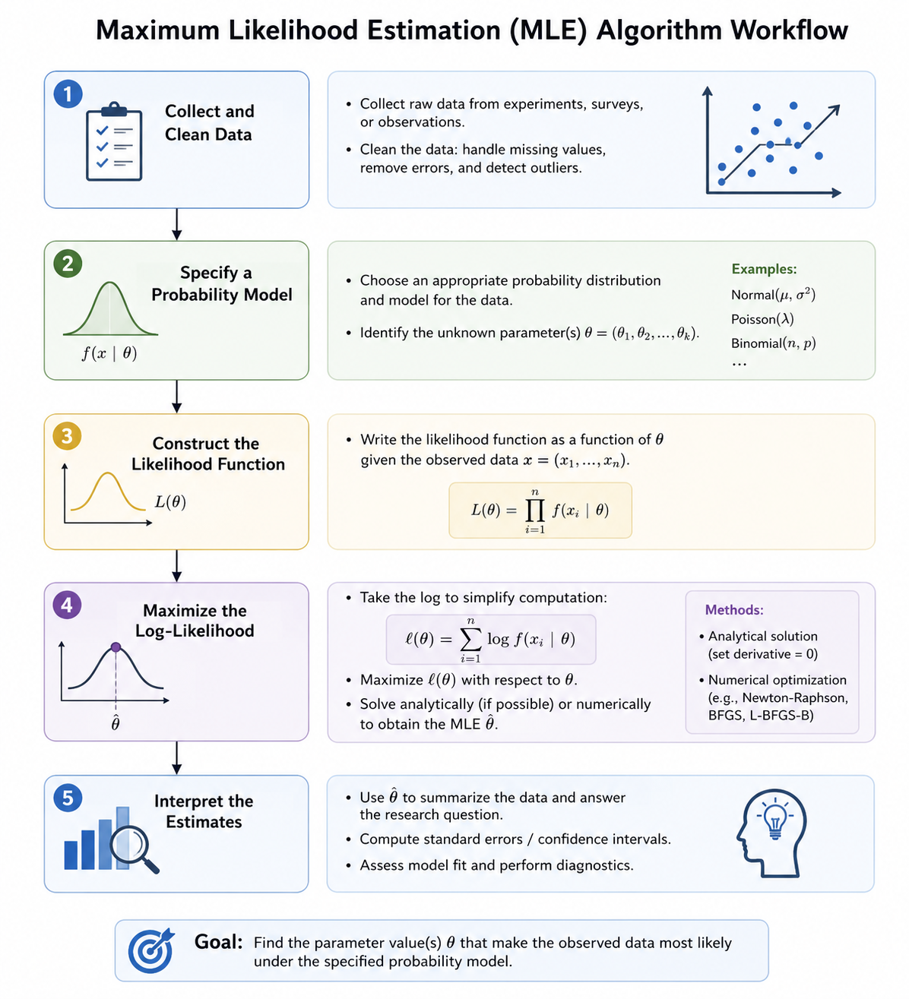

## 1 Introduction to MLE

***(Audio 00:15 - 07:37)***

### 1.1 Background, Concepts, and Purpose

Statistical inference aims to estimate unknown population parameters from observed data. In likelihood-based inference, the observed data are treated as fixed after collection, while the unknown parameter is varied to examine which value best explains the data.

[**Maximum Likelihood Estimation (MLE)**](https://doi.org/10.1214/ss/1030037906) **is a parameter estimation method. It does not assign a prior distribution to the parameter. Instead, it starts from an assumed probability model and estimates the parameter value that makes the observed data most likely to occur.**

| Terminology | Definition |
|------------------------------------|------------------------------------|
| Observed data | Collected sample values, denoted as $x$ or $x_1, ..., x_n$; treated as fixed after observation. |
| Parameter | Unknown model quantity, denoted as $\theta$; e.g., mean, variance, rate, or coefficient. |
| Probability model | A statistical model that describes how data are generated under a given parameter value, written as $f(x \mid \theta)$. |
| Likelihood | A function measuring how compatible different parameter values are with the observed data, written as $L(\theta) = P(x \mid \theta)$. |
| Maximum Likelihood Estimation (MLE) | A method that estimates $\theta$ by choosing the value that maximizes $L(\theta)$. |

MLE is powerful because it gives a unified framework for parameter estimation. Once the probability model is specified, **the estimation problem becomes an optimization problem**. This is especially useful when the model is too complex for simple manual estimation.

Many modern statistical models are estimated using MLE, including logistic regression, linear mixed-effects models, Gaussian mixture models, hidden Markov models, and multinomial classification models.

### 1.2 Requirements and Assumptions

However, MLE is not automatically reliable. Its result depends strongly on several assumptions:

1.  **Correct model specification**

    -   MLE assumes that the chosen probability model is appropriate for the data.
    -   If the model is specified improperly, MLE may have limited scientific meaning.

2.  **Independent observations**

    -   Many standard MLE procedures assume that observations are independent.

    -   Under this assumption, the joint likelihood can be written as the product of individual likelihoods.

3.  **Identifiability**

    -   Different parameter values should imply different probability distributions.

    -   If two different values of $\theta$ generate the same distribution, the data cannot distinguish between them.

4.  **Successful optimization**

    -   For complex models, MLE often relies on optimization.

    -   The procedure should converge to the true maximum of the likelihood function rather than a local maximum or even divergence.

### 1.3 Real World Applications

**Environmental Science**

1.  **Estimating the rate of extreme rainfall events**

-   Scenario: Environmental scientists want to estimate how often extreme rainfall events occur in a region. The response variable may be the annual number of extreme rainfall days, while location, season, or climate zone may affect the expected event rate. Because extreme events are relatively rare, simple averages may not fully capture the underlying event-generating process.

-   MLE Application: MLE can be used to estimate the rate parameter of a Poisson or related count model. The method selects the parameter value that makes the observed pattern of extreme rainfall events most likely under the assumed model. This allows researchers to quantify event frequency and compare rainfall risk across regions.

2.  **Estimating pollutant concentration distributions**

-   Scenario: Environmental agencies want to model air or water pollutant concentrations, such as PM2.5, nitrogen dioxide, or nitrate levels. These concentrations are continuous variables and may vary across monitoring sites, industrial zones, seasons, or weather conditions.

-   MLE Application: MLE can estimate the parameters of a suitable distribution, such as a normal, log-normal, or gamma distribution. By fitting the distribution to observed pollutant measurements, researchers can estimate average pollution levels, variability, and the probability of exceeding environmental safety thresholds.

**Bioinformatics**

1.  **Estimating gene expression model parameters from RNA-seq data**

-   Scenario: Bioinformaticians want to compare gene expression levels between treatment and control groups using RNA-seq count data. The dependent variable is the read count for each gene, and the independent variable may be treatment condition, tissue type, or disease status. However, RNA-seq data are discrete, over-dispersed, and affected by library size.

-   MLE Application: MLE can be used to estimate parameters in count-based models such as Poisson or negative binomial models. The fitted model estimates gene-specific expression levels and dispersion parameters, allowing researchers to test whether observed expression differences are likely under the assumed data-generating model.

2.  **Estimating mutation or variant frequencies in sequencing data**

-   Scenario: Researchers want to estimate the frequency of a genetic variant in a population or tumor sample from sequencing reads. The observed data may include the number of reads supporting the reference allele and the number supporting the alternative allele. Sequencing depth, sampling variation, and technical noise can influence the observed counts.

-   MLE Application: MLE can estimate the most likely allele frequency by fitting a binomial or beta-binomial model to the sequencing counts. This helps determine whether a variant is rare, common, or enriched in a particular biological condition, and can support downstream interpretation in population genetics, cancer genomics, or viral evolution studies.

## 2 Algorithm of MLE

***(Audio 07:37 - 12:43)***

### 2.1 Algorithm Workflow

1.  Collect and clean observed data.
2.  Specify a probability model for the data.
3.  Write the likelihood function (convert it into log-likelihood).
4.  Maximize the log-likelihood analytically or numerically to obtain parameter estimates.
5.  Interpret the estimated parameter in the context of the problem.

> 
>
> *Fig. 1 Workflow of MLE algorithm.*

### 2.2 Mathematical Principle

**Step 1**

Suppose the observed data are $x_1, x_2, ..., x_n$, which are from independent and identical distributions (iid).

**Step 2**

The unknown model parameter is denoted by $\theta$.

**Step 3**

The likelihood function is the joint probability of the observed data, treated as a function of $\theta$, namely the probability of observing the entire sample $x_1, x_2, ..., x_n$ simultaneously under a given parameter value:

$$
L(\theta) = P(x_1, x_2, ..., x_n \mid \theta)
$$

​Because the observations are independent, the joint likelihood can be factorized as:

$$
L(\theta) = \prod_{i=1}^{n} f(x_i \mid \theta)
$$

​where $f(x_i \mid \theta)$ is the probability mass function (for discrete distribution) or probability density function (for continuous distribution) of one observation.

​Then the maximum likelihood estimate is defined as

$$
\hat{\theta}_{MLE} = \arg\max_{\theta} L(\theta)
$$

​In practice, the log-likelihood is usually maximized instead of the likelihood:

$$
\ell(\theta) = \log L(\theta)
$$

Since the logarithm is monotonic, maximizing $L(\theta)$ and maximizing $\ell(\theta)$ give the same estimate. The log-likelihood is easier to work with because it converts products into sums, which simplifies the derivative calculations:

$$
\ell(\theta) = \sum_{i=1}^{n} \log f(x_i \mid \theta)
$$

**Step 4**

Maximize the log-likelihood analytically or numerically to obtain the corresponding parameter estimate.

-   Analytical calculation: differentiate log-likelihood function with respect to the unknown parameter and setting the derivative equal to zero:

    $$
    \frac{d\ell(\theta)}{d\theta} = 0
    $$

    The solution to this equation gives a candidate maximum likelihood estimate: $\hat{\theta}_{MLE}$.

    To verify that this point is a maximum rather than a minimum, the second derivative should be checked. For a one-parameter model, the candidate estimate corresponds to a local maximum if

    $$
    \frac{d^2\ell(\theta)}{d\theta^2}\bigg|_{\theta=\hat{\theta}_{MLE}} < 0
    $$

    This condition means that the log-likelihood curve is concave downward at $\hat{\theta}_{MLE}$, so the stationary point represents a maximum.

-   Numerical optimization: iterate and search for the parameter value that maximizes the log-likelihood.

### 2.3 Example - Poisson Distribution

The Poisson distribution is suitable for modelling count data measured over a fixed time period or spatial unit. Suppose the observed count data are assumed to be independent and identically distributed from a Poisson distribution. **We try to figure out the parameter** $\lambda$ **for the Poisson distribution using MLE in three different methods.**

#### 2.3.1 Analytical Implementation by Hand

Assume that the observed counts are:

$$
x_1, x_2, ..., x_n \overset{iid}{\sim} Poisson(\lambda)
$$

The probability mass function of one observation is:

$$
P(X_i = x_i \mid \lambda) = \frac{e^{-\lambda}\lambda^{x_i}}{x_i!}
$$

Because the observations are assumed to be independent, the likelihood function is:

$$
L(\lambda) = \prod_{i=1}^{n} \frac{e^{-\lambda}\lambda^{x_i}}{x_i!} =
\frac{e^{-n\lambda}\lambda^{\sum_{i=1}^{n}x_i}}
{\prod_{i=1}^{n}x_i!}
$$

The log-likelihood is:

$$
\ell(\lambda)
=
\log L(\lambda)
=
-n\lambda
+
\left(\sum_{i=1}^{n}x_i\right)\log(\lambda)
-
\sum_{i=1}^{n}\log(x_i!)
$$

To find the maximum likelihood estimate, differentiate the log-likelihood with respect to $\lambda$:

$$
\frac{d\ell(\lambda)}{d\lambda}
=
-n
+
\frac{\sum_{i=1}^{n}x_i}{\lambda}
$$

Set the derivative equal to zero:

$$
-n
+
\frac{\sum_{i=1}^{n}x_i}{\lambda}
=
0
$$

Solving for $\lambda$ gives:

$$
\hat{\lambda}_{MLE}
=
\frac{1}{n}\sum_{i=1}^{n}x_i
=
\bar{x}
$$

To verify that this stationary point is a maximum, take the second derivative of the log-likelihood:

$$
\frac{d^2\ell(\lambda)}{d\lambda^2}
=
-\frac{\sum_{i=1}^{n}x_i}{\lambda^2}
$$

Since $\lambda > 0$ and $\sum_{i=1}^{n}x_i > 0$ for count data with at least one observed event:

$$
\frac{d^2\ell(\lambda)}{d\lambda^2} < 0
$$

Therefore, the log-likelihood is concave downward at the stationary point, confirming that:

$$
\hat{\lambda}_{MLE}
=
\frac{1}{n}\sum_{i=1}^{n}x_i
=
\bar{x}
$$

is a maximum rather than a minimum.

Therefore, for a Poisson model, the MLE of the rate parameter $\lambda$ is the sample mean.

#### 2.3.2 Numerical Implementation in R - Manually

```{r}
# simulate observed data
set.seed(123)
lambda_specified <- 5
x <- rpois(10000, lambda_specified)

# log-likelihood functions
loglik_poisson <- function(lambda, data) {
  sum(dpois(data, lambda = lambda, log = TRUE))
}

# search to find optimized parameters
lambda_grid <- seq(0.01, 10, by = 0.01)

loglik_values <- sapply(
  lambda_grid,
  loglik_poisson,
  data = x
)

lambda_numerical <- lambda_grid[which.max(loglik_values)]

plot(
  lambda_grid,
  loglik_values,
  type = "l",
  xlab = "Lambda",
  ylab = "Log-likelihood",
  main = "Poisson Log-likelihood Curve - Numerical Method"
)
abline(v = lambda_numerical, lty = 2)
points(
  lambda_numerical,
  loglik_poisson(lambda_numerical, x),
  pch = 19
)
```

#### 2.3.3 Numerical Implementation in R - `stats4::mle()` Package

```{r}
library(stats4)

# function for conducting MLE
neg_loglik_poisson <- function(lambda) {
  -sum(dpois(x, lambda = lambda, log = TRUE))
} # `mle()` minimize the input function, so we use negative log-likelihood

# MLE
fit_mle <- mle(
  minuslogl = neg_loglik_poisson, # function to calculate (minimization)
  start = list(lambda = 1), # initial values for optimization
  method = "L-BFGS-B", # the optimization method
  nobs = length(x), # number of observations
  lower = c(lambda = 0.01), # lower bounds on the parameters
  upper = c(lambda = 10) # upper bounds on the parameters
)

# Results & interpretation
summary(fit_mle)

lambda_package <- coef(fit_mle)[["lambda"]] # The estimated parameter can be extracted using coef()
```

-   `Estimate`: fitted MLE of lambda

-   `Std. Error`: uncertainty of the estimate

-   `-2 log L`: likelihood-based fit value, smaller is better

#### 2.3.4 Performance Comparison

Finally, lambda specified, from analytical MLE, numerical grid-search MLE, and package-based MLE are compared.

```{r}
# parameter comparison
lambda_analytical <- mean(x) # conclusion from the section above

(lambda_comparison <- data.frame(
  Method = c("Specified lambda", "Analytical MLE", "numerical MLE - Manual", "Numerical MLE - Package"),
  Lambda = c(lambda_specified, lambda_analytical, lambda_numerical, lambda_package)
))

print("All four lambda are close, validating all of our methods.")
```

## 3 R Application

***(Audio 12:43 - 16:14)***

### 3.1 Research Scenario

-   In the **Puromycin** dataset, reaction velocity (counts/min/min) was measured at different substrate concentrations (ppm) under two experimental conditions: treated and untreated. The treated group was exposed to Puromycin, while the untreated group serves as the control.

-   **Here we are interested in whether Puromycin treatment changes the enzyme kinetic behavior.**

### 3.2 Modeling

-   Enzyme reaction rate often depends on substrate concentration. The enzyme kinetic behavior is usually measured through the [Michaelis-Menten model](https://doi.org/10.3390/molecules27010263):

    $$
    v_i = \frac{V_{max}S_i}{K_m + S_i}
    $$

    In particular, $V_{max}$ represents the maximum reaction velocity, while $K_m$ represents the substrate concentration required to reach half of $V_{max}$.

-   The deterministic Michaelis-Menten curve is combined with normally distributed measurement error to form a likelihood model:

$$
v_i \sim Normal\left(\frac{V_{max}S_i}{K_m + S_i}, \sigma\right)
$$

-   **The goal is to estimate the parameters (**$V_{max}$**,** $K_m$**, and** $\sigma$**) for the treated and untreated groups using MLE based on the observed data.**

### 3.3 R Implementation

**Step 1: Data preparation**

```{r}
library(stats4)

data(Puromycin)
head(Puromycin, 3)

puro_treated <- subset(Puromycin, state == "treated")
puro_untreated <- subset(Puromycin, state == "untreated")
```

**Step 2: Brief visualization**

```{r}
group_cols <- ifelse(Puromycin$state == "treated", "red", "blue")

plot(
  Puromycin$conc,
  Puromycin$rate,
  col = group_cols,
  xlab = "Substrate concentration",
  ylab = "Reaction velocity",
  main = "Puromycin Enzyme Kinetics Data",
  pch = 19
)

legend(
  "bottomright",
  legend = c("treated", "untreated"),
  col = c("red", "blue"),
  pch = 19,
  bty = "n"
)
```

**Step 3: Reusable MLE function construction**

```{r}
fit_mm_group <- function(data) {
  S <- data$conc
  v <- data$rate

  # negative log-likelihood function
  neg_loglik_mm <- function(Vmax, Km, sigma) {
    mu <- Vmax * S / (Km + S)
    -sum(dnorm(v, mean = mu, sd = sigma, log = TRUE))
  }

  # MLE, with initial parameters setting according to their own statistical meanings
  fit <- mle(
    minuslogl = neg_loglik_mm,
    start = list(Vmax = max(v), Km = median(S), sigma = sd(v)),
    method = "L-BFGS-B",
    nobs = length(v),
    lower = c(Vmax = 0.001, Km = 0.001, sigma = 0.001),
    upper = c(Vmax = Inf, Km = Inf, sigma = Inf)
  )
  
  return(fit)
}
```

**Step 4: Fit MLE for both groups**

```{r}
fit_treated <- fit_mm_group(puro_treated)
fit_untreated <- fit_mm_group(puro_untreated)

summary(fit_treated)
summary(fit_untreated)
```

**Step 5: Parameter comparison**

```{r}
(parameter_comparison <- data.frame(
  group = c(
    "treated", 
    "untreated"
    ),
  Vmax = c(
    coef(fit_treated)[["Vmax"]],
    coef(fit_untreated)[["Vmax"]]
  ),
  Km = c(
    coef(fit_treated)[["Km"]],
    coef(fit_untreated)[["Km"]]
  ),
  sigma = c(
    coef(fit_treated)[["sigma"]],
    coef(fit_untreated)[["sigma"]]
  )
))
```

**Step 6: Visualization**

```{r}
library(ggplot2)

S_grid <- seq(
  min(Puromycin$conc),
  max(Puromycin$conc),
  length.out = 200
)

curve_data <- data.frame(
  conc = rep(S_grid, 2),
  rate = c(
    coef(fit_treated)[["Vmax"]] * S_grid / (coef(fit_treated)[["Km"]] + S_grid),
    coef(fit_untreated)[["Vmax"]] * S_grid / (coef(fit_untreated)[["Km"]] + S_grid)
    ),
  state = rep(c("treated", "untreated"), each = length(S_grid))
)

ggplot(Puromycin, aes(x = conc, y = rate, color = state)) +
  geom_point(size = 2.8, alpha = 0.85) +
  geom_line(
    data = curve_data,
    aes(x = conc, y = rate, color = state),
    linewidth = 1.1
  ) +
  scale_color_manual(
    values = c(
      "treated" = "red",
      "untreated" = "blue"
    )
  ) +
  labs(
    title = "Michaelis-Menten Curves Fitted by MLE",
    x = "Substrate concentration",
    y = "Reaction velocity",
    color = "Group"
  ) +
  theme_classic(base_size = 13) +
  theme(
    plot.title = element_text(hjust = 0.5),
    legend.position = "bottom"
  )
```

-   The fitted curves show a saturating response, which is consistent with Michaelis-Menten kinetics.

-   The treated curve reaches a higher upper reaction velocity, matching the larger estimated $V_{max}$.

**Step 7: Result Interpretation**

$Vmax$:

-   Estimated maximum reaction velocity.

-   For the treated group, $V_{max} = 212.69$; for the untreated group, $V_{max} = 160.30$.

-   The treated group has a higher estimated $V_{max}$, meaning that the fitted maximum reaction velocity is higher after Puromycin treatment.

$Km$:

-   Substrate concentration required to reach half of $V_{max}$.

-   For the treated group, $K_m = 0.0641$; for the untreated group, $K_m = 0.0477$.

-   The treated group has a higher $K_m$, meaning that more substrate is needed to reach half-maximal velocity.

$\sigma$:

-   Residual variation around the fitted Michaelis-Menten curve.

-   For the treated group, $\sigma = 9.98$; for the untreated group, $\sigma = 8.84$.

-   The treated group has slightly larger residual variation, meaning that its observed reaction rates are slightly more variable around the fitted curve.

$-2 log L$:

-   Likelihood-based model fit value.

-   The treated group has $-2 \log L = 89.27$, while the untreated group has $-2 \log L = 79.16$.

-   This value mainly summarizes likelihood fit within each fitted model. It should not be over-interpreted alone, especially because the two groups are fitted to different subsets of data.

Overall, the MLE-fitted Michaelis-Menten models suggest that Puromycin treatment increases the maximum reaction velocity ($V_{max}$), but also increases the substrate concentration required to reach half of that maximum ($K_m$). Therefore, the treated samples show a higher upper reaction capacity, while the untreated samples reach half-maximal velocity at a lower substrate concentration.

## 4 Conclusion

***(Audio 16:14 - 16:47)***

**Maximum Likelihood Estimation (MLE) estimates parameters by choosing the values that make the observed data most likely under a specified probability model.**

**Overall, the project shows that MLE is not only a formula-based estimation method, but a general framework for fitting probability models, interpreting parameters, and connecting statistical estimation with real scientific questions.**

## 5 Other Information

-   [Audio recording](Yuewei_Xu_ENV222_Project.mp3):

    -   Introduction: 00:15 - 07:37

    -   Algorithm: 07:37 - 12:43

    -   R Application: 12:43 - 16:14

    -   Conclusion: 16:14 - 16:47

-   [A video for more information](https://www.youtube.com/watch?v=rCdxlN6Ph14)

-   Session information:

```{r}
sessionInfo()
```
